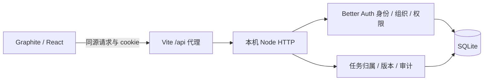

# Graphite 接通真实 API 的验证

2026-10-13。用户在自适应修正后表示“我觉得这个可以”，并同意沿 Graphite 打通登录、组织、项目任务与保存。已有视觉/动效选择沿用，没有再次发风格问卷或替换技术栈；新增登录、权限与恢复状态仍待后续使用反馈。

## 实际实现

React/Vite 页面使用同源 `/api` 代理；Better Auth 1.7.7 管理真实身份、会话、组织与角色。Node HTTP 复用 @hono/node-server 2.1.5，业务适配实现项目归属、任务版本与审计事务。安装版本/许可见 [实际依赖](evidence/relay-api/DEPENDENCIES.json)，官方实现依据：[组织插件](https://better-auth.com/docs/plugins/organization)、[Node HTTP 适配](https://hono.dev/docs/getting-started/nodejs)。

这些连接已实现并验证。源码工程为 `relay-preview`：`src/api.ts` 负责请求与读取契约，`src/workspace-state.ts` 负责请求代次与数据状态，`server/app.mjs` 核对组织/角色并提交，`server/schema.sql` 为业务关系，`server/runtime.mjs` 保持本地数据库与随机 secret。完整 ER 图、保存时序和实际文件链接在该工程 `docs/ARCHITECTURE.md`。

初始任务仍是明确的本地演示内容，之后保存是真实写入；刷新、登录与 API 启动不重置它。`pnpm seed` 显式准备账号和两组织，重复执行保留已保存更改。未复制实验的固定 secret 作为实际运行配置；`.data/` 不进入源码包。

## 浏览器与程序证据

[程序检查](evidence/relay-api/api-checks.json)、[19 项测试输出](evidence/relay-api/api-test-output.txt) 与 [浏览器记录](evidence/relay-api/api-browser-evidence.json) 分开保存。实际经历了：

| 路径 | 观察结果 |
| --- | --- |
| 错误密码 / 正确登录 | 错误文案可重试；真实会话读取林悦与可访问组织 |
| 保存 → 刷新 | RE-142 标题仍在，新版本可核对；状态保存后汇总为 6/12、50% |
| 双窗口同版本编辑 | 旧窗口收到冲突，草稿保留，不能直接重发覆盖 |
| 冲突恢复 | 展示服务器对象，显式载入后才替换草稿；失败后的焦点落到恢复按钮 |
| 切组织 / 只读详情 | 研协 12 项与星河 2 项分离，星河详情只读，没有保存入口 |
| API 停止 → 新进程启动 | 停止期间不报成功，草稿保留；启动后原会话读到之前保存的版本 |
| 服务器未改变时的重试 | 核对后保留原草稿与版本，继续保存；刷新读到该草稿内容 |
| 退出 | 返回登录表单，任务列表被清除 |

应用测试还覆盖真实 HTTP 会话、租户猜测/关联拒绝、角色拒绝、撤销/在途撤销、版本冲突、审计故障回滚、新进程读取、种子幂等、前端旧响应丢弃、注销与失败保存。`lint` 与生产构建通过，不能因此升级为生产验收。

新组织/账号入口在 320/390/600/1040/1440 宽度检查：任务、组织和退出入口保留，无页面横向溢出；登录检查 320/390。390×568 的取消与保存均高 44px、保持可见。视口测试后恢复到实际侧窗 598×704，再干净重载读取 12 项任务；捕获的新增控制台错误为零。开发中一次模块热更新停在加载态，改为按挂载的 App 保持状态实例，未用编辑阶段状态代替最终重载结果。

截图：[当前工作区](evidence/relay-api/workspace.jpg)、[登录](evidence/relay-api/login.jpg)、[冲突与恢复](evidence/relay-api/conflict.jpg)。测试后通过 UI 恢复原示例标题和状态，版本与审计保留真实操作轨迹。

## 沉淀回 skill

- 保持用户已接受的基础视觉，新增业务状态单独检查，不重复询问已确认项。
- 处理器、HTTP、浏览器和恢复分别证明；从孤立实验进到真实 UI 消费者后才能称相应路径接通。
- 失败与冲突不仅有错误文案，还需要草稿、最新版本、准确 pending 标签、恢复行动与键盘焦点。对应补充已落入 UI 参考。

当前读取上限 100 项，前端筛选已加载任务；“迭代 08”是示例展示上下文，未实现完整迭代领域。未验证生产环境、升级迁移、容量、跨平台、完整 WCAG、真机输入法、邮件、worker 或计费。这是本地真实纵向切片，不证明整个大型 SaaS 或 skill 已完全完善。

## 独立复核后的修正

最初 17 项应用测试通过后，独立源码复核发现两个 P2：失败恢复仍要求丢弃草稿，以及读取输入期间注销的会话仍可提交。两项已修正并复审；新增注销与到期场景先复现 200，再验证 401 且任务/版本/审计不变。当前 19 项测试通过，源码复审未发现这两处修正中的新具体重要问题。审查员没有操作浏览器，保留草稿重试由主 Agent 在真实 API 停止/重启后另行验证，见 [重试入口](evidence/relay-api/retry-draft.jpg) 和浏览器记录。
