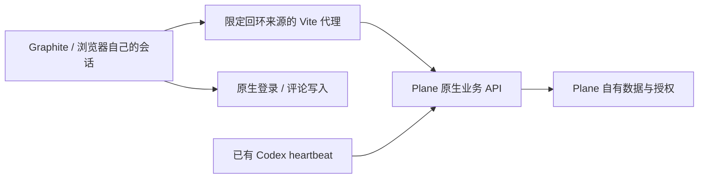

# Graphite 复用现有 Plane 的真实接入

2026-10-14。用户要求继续，将 Graphite 的任务列表、详情和编辑接入已有 Plane。前端保留构图、Radix 控件和 Motion；认证、项目授权、任务持久化、评论与后台任务由现成 Plane Community v1.4.2 承担。没有给所有前端用户共享管理员 key，没有从实验的 Better Auth/SQLite 重建平台。

接入从部署版本的原生源码与实际响应核对，不把最新版公共 API 当作现有前端会话协议。状态使用原 ID、名称与组，待验收不映射为完成；UUID 用于请求，ACUI 编号用于展示。未分配的负责人和日期保持事实。详情读取原任务及评论，反馈入口链接原生讨论；未新增评论存储或任务执行器。

保存使用已有 store/编辑器与失败恢复：读取 updated_at 起点，只发送实际改变的字段；204 后重新读取并核对结果。已实际发现上游此路径没有原子 CAS，业务 API 也跳过 CSRF token 校验。代理限制本机来源并要求显式写入请求头，原生登录表单继续按自身 CSRF 流程；不能把这些措施称为上游业务 token 校验或完整并发保护。

真实浏览器读取六项任务和执行回执，在 Graphite 修改名称/状态后原生接口读回一致，刷新保留；测试名称恢复。390×568 列表与长评论详情没有横向溢出，保存按钮保持可见；原任务状态变化后，旧草稿被拒绝并保留，显式载入恢复。26 项测试、lint/build 通过，其中七项新适配检查使用可控 HTTP 边界，不能当作七项真实 Plane 端到端测试。

证据见 [当前工作区](evidence/plane-integration/current-workspace.png)、[窄屏详情](evidence/plane-integration/mobile-detail.png)、[检查与指纹](evidence/plane-integration/report.json)。原文件和运行日志在本机 `G:/skill/relay-preview/docs/plane-integration/`，详细架构、时序与运行入口在 `G:/skill/relay-preview/docs/PLANE_INTEGRATION.md`。原生 ACUI-6 已回填并保持待验收，自己的执行记录被定时检查排除。

未验证：真实多人授权、原子写冲突、新登录/退出完整浏览器流程、网络故障注入、完整无障碍、容量及生产发布。原名称恢复不代表删除测试的更新/审计；本轮只提交任务业务切片，不代表全部视觉二开、skill 或整个项目完成。
