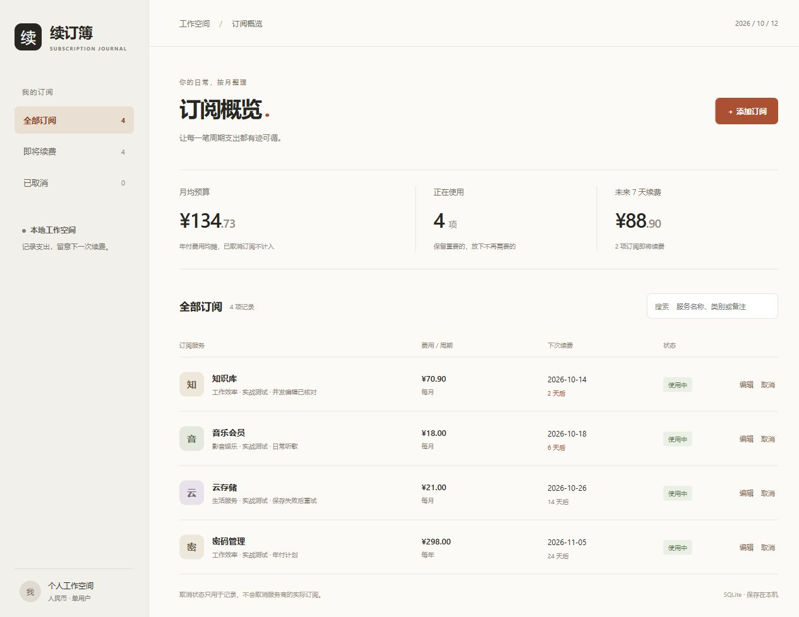
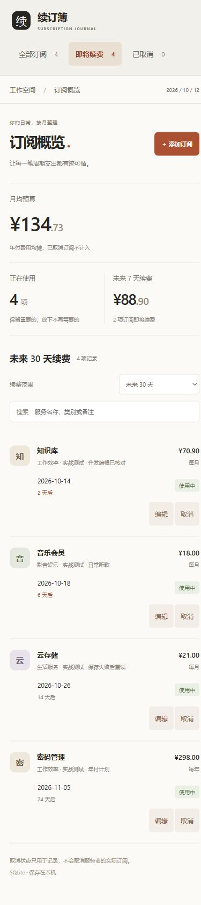

# 真实项目验证：续订簿

2026-10-12，在 Windows / Codex Desktop 中，用当前 skill 推进一个本地订阅管理应用。源项目位于本次工作空间的 `G:\skill\subscription-lab`，与 skill 仓库分开；本仓库保存验证记录与最终截图，不包含应用源码或用户数据库。

## 实际范围与过程

单用户、人民币、添加/编辑/标记取消/恢复、搜索、月均预算与续费列表。先做显式标注的内存原型，再沿数据适配层接 Node HTTP 与 SQLite，最后追加 30 天筛选并生成生产静态产物。无账户、支付或服务商连接。界面说明“取消”只更新本地记录。

Node.js 24.15.0，使用内置 SQLite 与 Node 测试，没有安装 Biome、Zod、UI 框架或第三方 npm 包。原型与真实模式沿用同一套领域校验。金钱用整数分，年付汇总后折算月均；续费按上海日历日期计算。

| 验证 | 结果 |
| --- | --- |
| 原型主路径 | 实际添加、编辑、取消；1.234 元错误被拒绝且保留输入；模拟数据标注清楚 |
| 真实读写 | 实际 UI 创建/编辑/取消/恢复，刷新保留记录；临时 SQLite 重启测试通过 |
| 契约 | JSON/日期/金额/版本/来源边界按真实 HTTP 验证，旧版本不能写入 |
| 后续需求 | 7 天扩展为可选择 30 天；第 30/31 天边界回归通过，浏览器看到第 24 天记录 |
| 索引 | 修改后旧快照退出 1；重新生成后退出 0；新鲜只限已索引范围 |
| 错误恢复 | 服务在提交前断开，界面显示连接错误并保留表单；恢复后保存成功 |
| 多页面冲突 | 真实双页面修改费用，旧页面收到 409，载入最新费用后再编辑，未回退对方修改 |
| 生产路径 | `npm run build` 成功；dist 页面与真实保存路径通过 HTTP 测试，并在浏览器验证 |
| 界面 | 1280/390/320 宽度检查、Tab/Escape、最终生产控制台检查通过 |
| 自动检查 | 应用 `npm test` 15 项通过；skill 索引脚本 16 项回归另行保持通过 |

构建只进行语法检查、五个静态文件打包与哈希清单，没有压缩、转译或性能优化；本实验未部署。

## 真正暴露的问题与修订

独立审查在现有 13 项通过的测试之外找到两个 P2：409 后把编辑版本换成最新，却保留整份旧表单，下一次保存会覆盖其他窗口的费用；页面初始化的“今日”在跨午夜后继续使用。

修复后加两项执行真实前端控制器的状态回归，先观察失败，再转绿；浏览器双页面另外验证了冲突路径。复审通过。可控时钟覆盖呈现、重新激活和定时跨日刷新，没有在浏览器里等待午夜。

因此只给 skill 补充三类指导：

1. 原型、真实数据、需求变更与交付各自的可观察完成条件。
2. 冲突后明确载入最新记录或合并，不能只换版本重发旧字段；本地状态与外部副作用表述一致。
3. 日期驱动页面核对时区、长开页面和跨日刷新。

没有把 SQLite、44px、人民币、上海时区或本实验的具体组件变成所有项目的强制方案，也没有因本轮增加 AST 或额外工具。

## 能力判断与限制

证据支持：本轮可以按 skill 指导贯通原型、真实数据和后续改动，并识别索引与交付证据的边界。技能当前更像开发与验收流程，视觉品质还依赖 Agent 的设计判断。

本次另用了 frontend-skill 辅助视觉实现，以及技能编写、测试与独立审查指导。没有在同一真实项目做无 skill/原版的对照，不能把成品效果全部归因于 agentic-craft-ui，也不能推导成功率、Token 节省或跨模型优势。

未验证其他操作系统、Claude Code 等宿主、完整无障碍审计、性能基准、长文本组合截图或公网运行。断网测试没有覆盖写入成功但响应丢失，应用没有创建幂等键。本轮是在 Codex 中验证跨平台指令的可执行性，不是完成跨平台运行矩阵。

