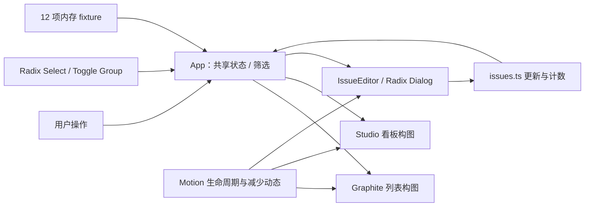

# Relay：按能力复用的视觉比较

## 输入与用户选择

用户要求面向产品与研发团队的大型协作 SaaS，并否定了此前原型的质感、缺少澄清和通用能力重复自建。已经确认比较两个有明显差异的视觉与交互方向，并比较两种动效节奏。

当被要求选择“独立品牌”或“整套产品二开”时，用户回答：该独立独立，该二开二开。随后按能力组合推进，不再用互斥整项目路线要求用户替代工程选型。

2026-10-13，用户看过预览后选择 **Graphite：紧凑列表与冷色工作区**；动效回答 **先继续调整再决定**。视觉方向已有选择，动效尚未认可，不能把二者一起记成已批准。

## 本次执行

官方 Vite React TS 模板启动工程，实际安装并使用 Radix Dialog / Select / Toggle Group、Motion、Fontsource、Lucide。独立实现品牌、构图和语义配色。任务 fixture、更新和计数由两版共用。

| 能力 | 处理 | 当前结果 |
| --- | --- | --- |
| 构建、类型检查、开发服务 | 官方模板 | 真实构建 |
| 弹窗、选择器、键盘与焦点 | Radix + 应用适配 | 可操作任务详情与筛选 |
| 动画生命周期与布局 | Motion + 产品节奏 | 两档可比较，支持减少动态 |
| 字体与 SVG 图标 | 本地依赖 | 统一图标语言与中英文字体 |
| 品牌与工作区布局 | 独立设计 | 侧栏列表 / 横向看板 |
| 任务数据 | 本页内存 fixture | 验证界面一致性 |
| 认证、组织、业务持久化、异步设施 | 待后续匹配接入 | 未实现，不能算 SaaS 验收 |

没有引入一个完整 SaaS starter 或 fork；这阶段的真实复用发生在框架和模块层。独立品牌与库级复用并不冲突，后续也允许模块二开。不能把本案例的 React / Radix 组合强制成其他项目的默认技术栈。

## 浏览器发现和修正

- 保存任务会更新对应列和进度；标题与状态共享，切换布局保留本页变化。
- Escape 取消草稿，关闭回到任务；任务离开当前筛选时回到工作区。
- Radix 选择器的 Escape 只关闭菜单；焦点循环和方向键 / Enter 筛选通过。
- 初版 Graphite 320px 有横向溢出，收起侧栏后也缺少项目入口；修正布局最小宽度并提供手机项目筛选。
- 初版 Studio 320px 标题换行过重；修正字号与单行标题。
- Studio 选中导航为 4.27:1，压深品牌色后实测 **5.00:1**。已检查 Graphite 的主要文字为 14.50:1，元信息 5.49:1；Studio 任务标题 12.14:1，元信息 5.18:1，编号 4.65:1。
- 两版实测 320 / 390px 的页面 scrollWidth 均未超过视口。
- 用户选择 Graphite 后继续调整动效：列表位移由表达性 14px 收敛为 6px，最长错峰缩短至 80ms；抽屉为 180 / 280ms，反馈 180ms。
- 移动中的抽屉出现一次入场时关闭未生效；Graphite 改为固定控件位置，使用淡入与边缘揭示。三个仍处于过渡中关闭的复测均关闭成功，并恢复到 RE-142。

实际观察和配对数值见 [浏览器记录](evidence/relay/browser-evidence.json)，依赖版本与许可证见 [依赖记录](evidence/relay/DEPENDENCIES.json)。截图：[Graphite](evidence/relay/graphite-desktop.png)、[Studio](evidence/relay/studio-desktop.png)。源码包为独立的 relay-preview 工程，当前 skill 包仅保存结果与证据。

## 工程视图

图只描述已运行的浏览器结构。认证和租户数据边界尚未接入，不能在图中伪装为已完成服务。

## 结论范围

应用的类型 / 构建和 oxlint 通过，两个领域约束测试通过；浏览器验证为限定交互、配色与视口检查。动效证据来自计算样式与截图，未测真机帧率、屏幕阅读器、完整 WCAG、跨模型或跨宿主运行。

用户已选视觉方向；动效仍在试调。该案例推进了真实预览与模块复用验证，**不证明 skill 已完善，也不证明大型 SaaS 已交付**。后续还需在选定方向中接入成熟身份 / 组织设施与真实业务路径，并独立验收。

## 后续用户反馈

用户随后认为动效可以，但成品质感与自适应仍有问题。最新复审、实际修正和认可边界见 [自适应复审](RESPONSIVE_REVIEW.md)；不能用上面的方向选择覆盖后续反馈。

## 继续完善后的状态

| 维度 | 当前状态 | 依据与下一步 |
| --- | --- | --- |
| 用户与业务 | selected | 产品/研发，多租户项目协作；沿用 |
| 复用策略 | selected | 按能力独立/复用/二开；不重问整项目二选一 |
| 视觉方向 | selected | Graphite；保持方向继续精修 |
| 动效 | accepted | 用户表示可以；受影响修改仍需回归 |
| 成品质感 | accepted（基础整体效果） | 后续用户表示“我觉得这个可以”；新增集成状态仍待反馈 |
| 自适应限定检查 | passed | 实际侧窗、边界两侧、长内容与详情；见复审范围 |
| 成熟身份/组织模块 | passed（本地集成） | 已接入 Graphite；见 [真实 API 路径](GRAPHITE_API_CASE.md) |
| 真实浏览器业务闭环 | passed（限定路径） | 登录/组织/任务保存/刷新/冲突/恢复；非完整 SaaS |

本表是当前迭代状态，历史章节保留当时结果。技术检查通过不改变用户判断，也不把整个 skill 或 SaaS 标为完成。
