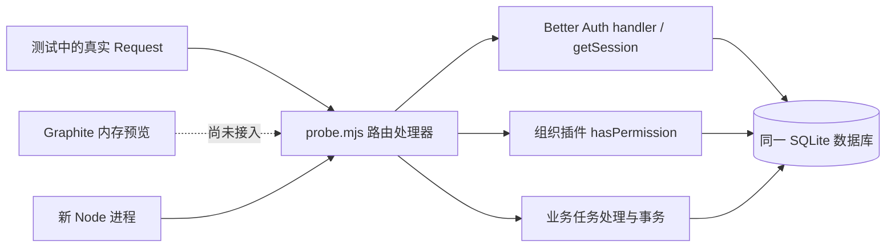
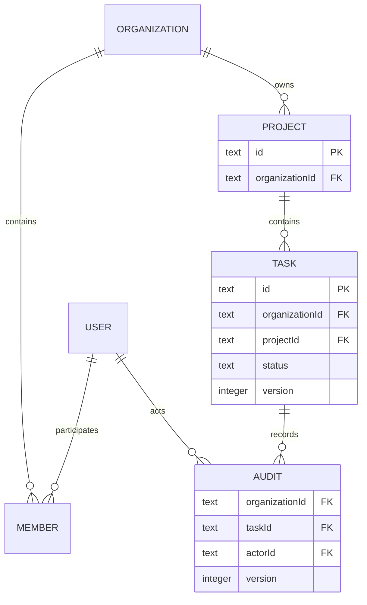
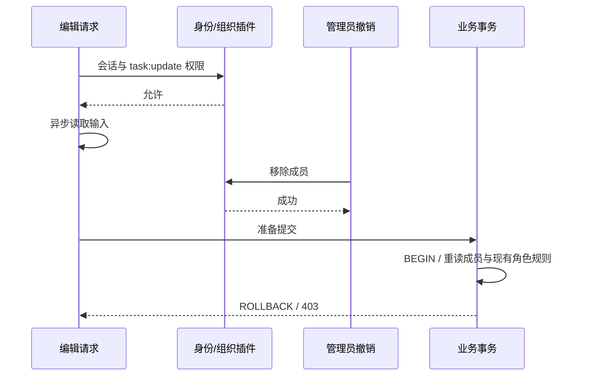

# 成熟身份与组织模块的限定集成验证

2026-10-13。用户已明确“该独立独立，该二开二开”，选择 Graphite，并表示动效可以，但仍否定成品质感。此次继续完善 skill，以运行实验检查复用边界；实验不代替视觉修正或用户认可。

## 选择与边界

现有预览是 React/Vite，任务存在浏览器内存。沿已有栈验证模块组合，比迁入整个 Next.js starter 更能回答当前的身份/组织问题；这不排除后续整套产品二开。选取 Better Auth **1.7.7 / MIT** 作为本地实验候选，认证、会话、组织、成员及权限计算使用库的实现，任务、项目和审计属于业务适配。

官方 [组织插件](https://better-auth.com/docs/plugins/organization)、[SQLite 适配](https://better-auth.com/docs/adapters/sqlite) 与 [程序化迁移](https://better-auth.com/docs/concepts/database) 已查阅，同时核对实际安装包与导出 API。Node **24.15.0** 内置 SQLite 适配运行通过；该驱动仍为 Release Candidate，不能将实验选型当成其他部署的默认生产方案。锁文件固定实际版本，不用新版官网文档推断旧版 API。

| 能力 | 负责方与本次结果 |
| --- | --- |
| 密码、注册、会话与身份读取 | Better Auth：真实 handler 获取会话后访问受保护边界 |
| 组织创建、成员加入/撤销、角色计算 | 插件与 access control：真实用户/成员，拒绝只读与撤销成员的写入 |
| 归属、输入、版本与原子审计 | 业务适配：两组织、复合外键、冲突与审计故障回滚 |
| 身份迁移 | 库的程序化迁移：运行认证前迁移，再初始化库 |
| 业务 schema | 幂等 SQL：新库/重开通过，升级迁移未测 |
| Graphite 与 API 连接 | 未接入，预览仍为内存数据 |

实验通过 `Request/Response` 处理器调用，不启动 HTTP listener，不能称浏览器端到端或 HTTP 联调通过。直接加成员只用于测试准备，使用库的 **server-only** API，没有开放浏览器提权接口；没有邮件或 worker。

## 实际边界图

实线为本次已实现、限定验证的调用；虚线为当前未实现的连接。



来源：[处理器](evidence/reuse/probe.mjs)、[业务 schema](evidence/reuse/schema.sql)、[重开进程](evidence/reuse/verify-reopen.mjs)。图只描述实际消费的公开 API，不推断库的内部调用。



图省略身份库内部表，只描述相关关系。项目 `(organizationId,id)` 唯一，任务的 `(organizationId,projectId)` 复合外键阻止跨组织关联，审计与任务采用同样的组织约束。事务读取库的 `member` schema，因此存在升级耦合；正式接入要维护适配测试。角色定义使用库的 access control，未重写权限引擎。

## 测试与实际发现

`pnpm test` **10 项通过**。环境、锁文件、源码 SHA-256 与实际输出见 [证据记录](evidence/reuse/evidence.json)、[运行输出](evidence/reuse/test-output.txt)、[身份测试](evidence/reuse/test/auth.test.mjs)、[业务测试](evidence/reuse/test/tasks.test.mjs)。

覆盖真实会话、任务创建/更新/读取、两组织列表及猜测 ID 隔离、只读拒绝、旧会话成员撤销、跨组织项目关联、无效输入/伪造 actor、同版本两个写入中的一个 409、审计存储失败回滚、新 Node 进程读取任务/审计/会话、跨来源写入拒绝与浏览器不能调用 server-only 加成员。

在途请求测试发现：授权已通过后异步读取输入，期间撤销成员，原实现仍返回 **200** 并提交。修正为在同一 SQLite 写事务内重读可变成员关系，并消费同一份库角色定义；复测返回 **403**，标题、版本和审计数不变。不是只验证下一次新请求被拒绝。



仅测成员撤销，未覆盖读取期间注销或角色改变的所有竞态。单 SQLite 事务策略不直接推广到其他数据库、动态权限或分布式系统。

## 复现与当前状态

复制完整 `docs/evidence/reuse/` 到独立工作目录，使用 Node 24.15.0 与 pnpm 11.5.0，运行：

```text
pnpm install --frozen-lockfile
pnpm test
```

包仅为本地兼容性实验，公开固定测试 secret **不可用于实际部署**。测试使用临时库与模拟账号；证据不包含密码、会话 cookie 或数据库文件。这个测试副本不是 skill 运行依赖，其他框架任务不需要安装它。

| 检查 | 状态与含义 |
| --- | --- |
| 模块/业务处理器、权限、事务与新进程读取 | passed，限定 10 项行为 |
| HTTP 服务、浏览器 cookie 与 Graphite UI 联调 | not-run |
| 邮件、邀请投递、worker、导出、完整分页 | not-run，未实现 |
| 负载、生产配置、升级迁移与跨平台矩阵 | not-run |
| 用户对新视觉质感的认可 | pending，实验不改变此状态 |

本次从真实失败补充提交边界的可变权限检查，并区分处理器与 HTTP/UI 证据；同时完善候选实验与反馈状态。它使本轮结论更可复核，尚未证明 skill 的普遍能力提升或完整大型 SaaS 可用。
