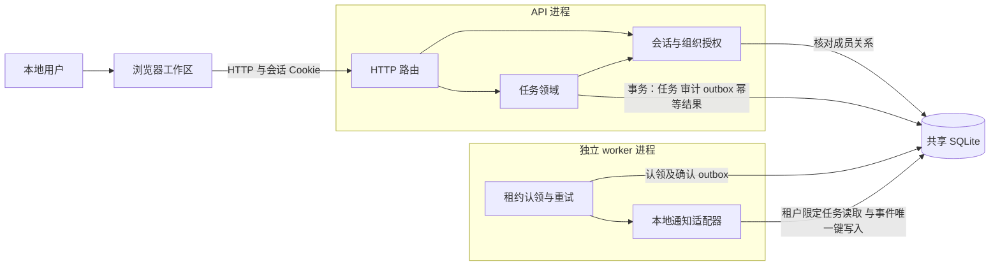
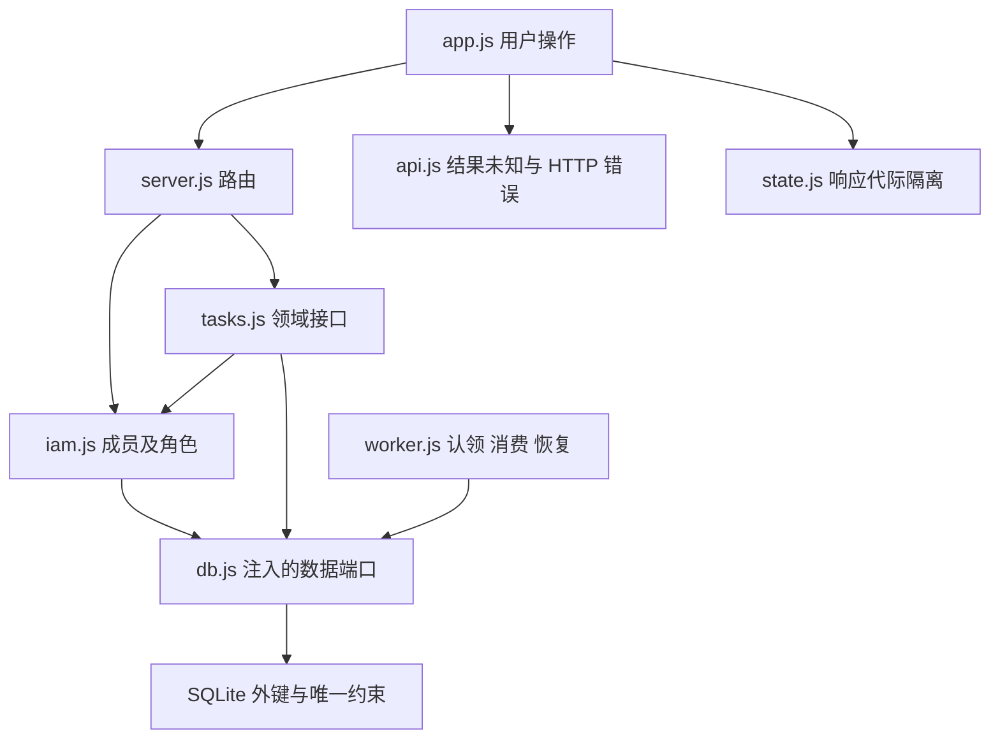
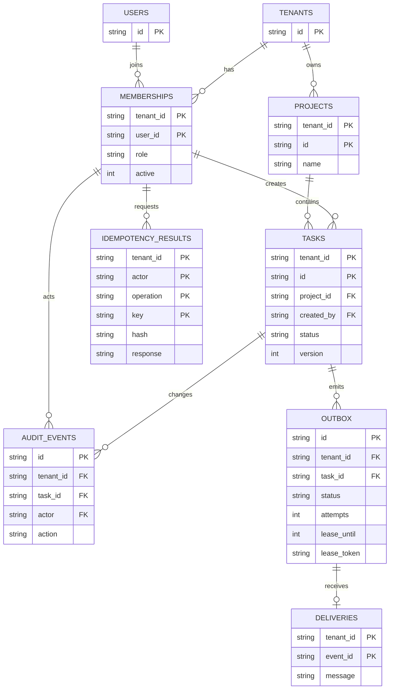
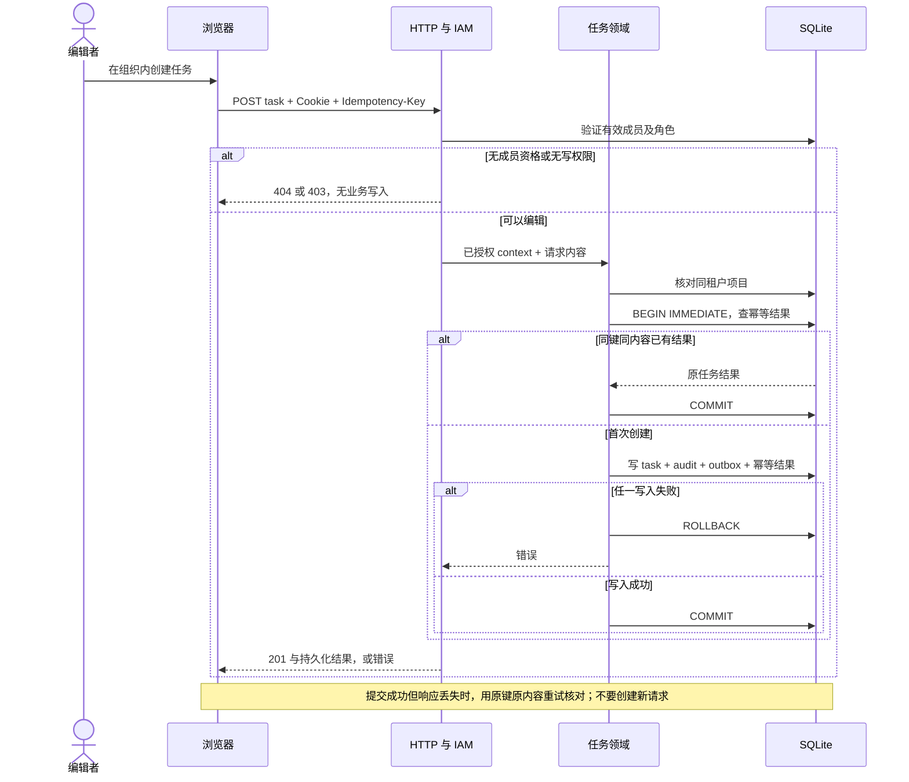

# SaaS 架构案例：Orbit

本案例来自独立本地工程 `saas-collab-lab`，工程源码不复制进 skill 的指令目录。它是架构与跨模块的纵向切片，不是大型 SaaS 生产容量验证。图中的源码路径相对该工程根目录。

后续用户反馈：此案例的产品/视觉质感未通过，通用底座的自建也未经过充分复用评估。它仅保留为限定的工程路径证据，不是推荐的 SaaS starter、视觉模板或“零依赖优先”示范。纠正与候选资料见 [开工复审](PREFLIGHT_REVIEW.md)；14 项行为检查不替代这条反馈。

已执行：14 项应用测试，覆盖 HTTP 租户/角色边界、同事务记录、幂等、版本冲突、分页搜索、outbox 写入失败回滚、真实提交后代理丢响应、客户端响应体中断、旧组织慢响应、worker 退避与租约/去重恢复。浏览器真实创建/更新/刷新、只读组织、编辑者范围、审计、独立 worker 的 5 条通知记录，以及 320/390/700/701px 布局检查通过；初测窄屏 grid 被导航撑宽，已修复并保留失败记录。

本地身份入口不是生产认证，通知不是外部邮件。进程崩溃通过未确认认领及新连接模拟，没有实际 kill worker；响应丢失通过 HTTP 代理/客户端传输端口，没有浏览器故障注入。生产登录、成员生命周期、计费、多实例、容量、备份恢复和完整审计未验证。Mermaid 为可维护源码，未运行独立渲染器；实际 HTML 架构页已在浏览器展示、截图。

冷启动场景见 [SaaS 行为评估](../tests/behavior/saas.md)，仍为 not-run；切片不是跨模型或无 skill 对照。下面是与本地实现核对的架构。

2026-10-13，Node 24.15.0 / Windows / Codex。这是用于验证架构边界的本地纵向业务切片；两组织、三身份、三角色、三预置项目，任务使用真实 HTTP 和 SQLite。不是生产大型 SaaS 或容量证明。

图中当前节点为 **implemented**；具体路径的 **verified** 状态见上面的执行范围。生产登录、成员邀请/撤销、计费、外部邮件、文件、SSO 与多实例扩容是 **not implemented / not-run**，没有把这些组件画成现有实现。项目列表预置，未实现项目 CRUD。

## 决策与边界

选择模块化单体 API + 独立 worker：在本地验证事务与异步恢复，同时保留明确模块接口。Node 标准库与 SQLite 降低本实验的依赖成本，不能从这项选择推导生产应使用相同栈。进程为 API 和 worker；本地通知接收器是 worker 中的函数，不是第三个服务。

用户与组织全局注册；memberships 记录组织资格与 owner/editor/viewer。任务创建、状态变化由任务模块拥有；浏览器不能写审计、outbox 或数据库。Tasks 调用 IAM 的写权限规则，通过注入的数据库端口完成同事务记录。worker 只认领已提交的 outbox。

本地 `/api/dev/session` 从示例身份列表签发随机、HttpOnly/SameSite Cookie，内存保存会话，重启需重新选择身份；不模拟成真实用户认证。所有租户 API 每次在服务端核对 actor 的有效成员关系，body 中的 role/tenant 不授予权限。

## 1. 系统边界与运行单元

API 和 worker 共享本机数据库文件。浏览器输入是非可信边界；租户 URL 是选择信息，必须经 IAM 验证。SQLite 文件访问属于可信服务边界，没有公开到浏览器。worker 不是第二套租户授权入口，也不接受客户端直接触发的作业数据。

## 2. 模块与源码依据

| 责任 | 依据 / 公开边界 |
| --- | --- |
| HTTP、请求大小/来源、静态文件 | `src/server.js` / `createApp` |
| 会话、组织列表与角色 | `src/iam.js` / `createIdentity.context`、`requireWrite`、`requireOwner` |
| 列表、详情、创建、更新、审计、后台结果 | `src/tasks.js` / `createTasks` |
| schema、复合键、事务、索引 | `src/db.js` / `openDatabase`、`tx` |
| worker 租约、退避、去重 | `src/worker.js` / `claimReady`、`runOnce`、`deliverLocally` |
| 工作区、写入反馈、真实接口消费 | `public/app.js` |
| HTTP 错误及响应体中断分类 | `public/api.js` / `api` |
| 忽略旧组织的迟到响应 | `public/state.js` / `createLoader` |

模块图表示责任与数据端口依赖，不是自动导出的完整 import/call graph。没有从 export 索引猜测架构。

## 3. 数据模型与不变量

- 项目 PK `(tenant_id,id)`；任务 PK 同样包含 tenant，项目外键为 `(tenant_id,project_id)`。关联不能只依靠全局 UUID。
- 创建者及审计 actor 引用 `(tenant_id,user_id)` 成员键；审计和 outbox 引用同租户任务。应用不提供删除成员、组织或任务接口；历史记录保留策略尚未设计完整。
- 幂等结果 PK `(tenant_id,actor,operation,key)`，绑定规范化的标题/项目内容哈希；重试返回原结果，同键异内容 409。持久化结果目前无 TTL/清理策略，非生产无限增长方案。
- 更新通过当前 version 核对后在写事务内递增；旧版本 409。当前状态枚举 todo/doing/done，允许在三种状态间切换，不含审批或复杂工作流。
- task、audit、outbox、创建幂等结果同事务提交；outbox 插入失败，其他写入回滚。列表、搜索、汇总及分页同时限定 tenant；分页 1–100、稳定按创建时间/id 排序。offset 分页不是大数据吞吐方案。
- deliveries 唯一键 `(tenant_id,event_id)`。本地接收器可去重；不能推导外部邮件、支付恰好一次。事件消费读取当前任务标题，不保存完整变更快照，不保证同一任务的事件投递顺序。

## 4. 创建事务与失败流程

同键异内容在写事务中返回 409 并回滚；并发更新的旧 version 返回 409。前端保存结果未知时锁住原内容，允许用同键核对；未在浏览器注入“成功后丢响应”，该路径通过真实 HTTP 代理测试。

worker 认领采用短数据库事务、随机 lease token 和 30 秒租约。独立进程循环消费：成功确认；失败 1s/2s 退避，第三次进入 dead；processing 过期可重认领，第三次认领后过期则 dead。旧 token 不能确认新租约。本地通知写入与确认分开，接收器已成功但确认前崩溃，可凭唯一键去重。

## 接口与权限

| 路径 | 角色 | 行为 |
| --- | --- | --- |
| `POST /api/dev/session` | 本地示例入口 | 选择三种示例身份，不是生产登录 |
| `GET /api/tenants` | 有效会话 | 仅自己的有效成员组织 |
| `GET /api/tenants/:tenant/projects` | 所有有效成员 | 预置项目列表 |
| `GET /api/tenants/:tenant/tasks`、`tasks/:id` | 所有有效成员 | 租户限定列表/搜索/分页与详情 |
| `POST /api/tenants/:tenant/tasks` | owner/editor | 标题、项目、幂等键；创建与审计/事件 |
| `PATCH /api/tenants/:tenant/tasks/:id` | owner/editor | title/status/version；旧版本 409 |
| `GET .../audit`、`.../operations` | owner | 当前组织最近 100 条记录 |

身份关系：Alice 是北辰 owner / 南岸 viewer；Bob 是北辰 viewer / 南岸 owner；Eve 仅北辰 editor。UI 禁用只是呈现，HTTP 权限另外验证。session 和授权失败分别为 401、403/404；输入错误 400/422；写入基础设施错误 500。

## 演进条件与尚缺的生产能力

数据、并发或多实例要求超过单机方案时，先测量热点、分页、锁等待和索引，再评估 PostgreSQL/租户隔离策略。图纸不能证明容量，也不预先安装 Redis、消息中间件或微服务。独立 worker 使异步边界可检验，但不是完整作业平台。

生产演进需要真实身份提供方及安全会话/CSRF策略、邀请/撤销与角色管理、密钥管理、迁移/备份恢复、日志关联、健康与告警、限流/公平性、死信人工恢复、幂等结果保留、数据保留删除、外部接收器去重，以及按目标规模的负载与故障验证。当前仅有本地功能、隔离、限定恢复与 UI 证据，不能称这些已完成。
